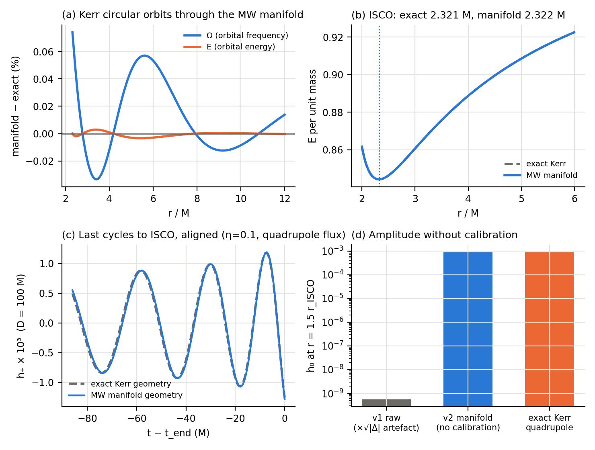

# Kerr Spacetime and Gravitational Waves through a Learned MW Manifold

**Modak–Walawalkar (MW) framework. A Bayesian manifold, trained on exact Kerr geodesics with the Kerr metric as a
physics prior, carries strong-field orbital geometry accurately enough for gravitational-wave data analysis. The
mismatch under Advanced LIGO noise is ≤ 5×10⁻⁵ for every spin from 0 to 0.95, with no amplitude calibration, on a
laptop CPU.**



---

## What is tested, in one paragraph

An MW variational manifold (8-D latent) is trained on exact Kerr timelike geodesics (675 k phase-space points for one spin, 1.3 M for the spin family). The
Kerr metric enters as a Bayesian prior: the geometry at a reconstructed point must match the geometry at the data
point. Every geometric quantity used for waveforms is then computed **through the manifold**. The metric is evaluated
at x̂ = decode(encode(x)), with r-derivatives taken by automatic differentiation through the encoder and decoder. This
gives the orbital frequency Ω(r), the binding energy E(r) and the ISCO. Adiabatic inspiral waveforms are built from
these and compared with waveforms built from exact Kerr under the **same** waveform model. The question is whether
geometry routed through a learned, ~100× compressed representation stays accurate enough for GW data analysis. **It
does, by two to four orders of magnitude** relative to the 0.97 template-bank standard.

> **What this is not.**
> - **It is not a new waveform model.** The inspiral is the textbook adiabatic, circular, equatorial, test-mass model
>   with quadrupole (or 2.5PN) flux, with no merger or ringdown.
> - **It is not discovery of the Kerr metric.** The analytic metric is supplied, both as the training prior and when
>   evaluating geometry at x̂. The network has to preserve the geometry, not invent it.
> - **It is not faster than LIGO's waveform models.** It is not a substitute for numerical relativity either.
>
> Inferring the metric from orbits alone, with no analytic form supplied, is the next step (§9). It is the step that
> carries over to spacetimes with no closed form.

---

## Headline results

**Spin a = 0.9, single-spin manifold (v2):**

| | Exact Kerr | MW manifold | Agreement |
|---|---|---|---|
| ISCO radius | 2.3209 M | 2.3224 M | 0.063% |
| Orbital frequency Ω(r), ISCO → 12 M | Bardeen–Press–Teukolsky | through the manifold | ≤ 0.074% (median 0.012%) |
| Binding energy E(r) | BPT | through the manifold | ≤ 0.0034% |
| GW amplitude h₀ at 1.5 r_ISCO | 8.864×10⁻⁴ | 8.858×10⁻⁴ | 0.07%, **calibration factor 1.0** |
| Inspiral to ISCO, 475 cycles (η = 0.01), flat noise | — | — | match 0.9998 |
| Same, **Advanced LIGO design noise**, M = 20–100 M☉ | — | — | match **0.99993 – 0.999999** |

**All spins, one manifold (v3, [`v3_spin_family/`](v3_spin_family/README.md)):**
- Spin is an input, and one model covers a = 0 → 0.95 (Schwarzschild to near-extremal).
- ISCO error is ≤ 0.12% over 39 spins.
- aLIGO match at six spins not used in training is **0.99995 – 0.999998** (M = 60 M☉, η = 0.01).

**Cost (Intel i5-12450H laptop CPU, no GPU):** data 220 s; training 62 min (v2) or 72 min (v3, all spins);
geometry extraction 0.3 s per spin. The waveforms themselves are generated by a standard adiabatic integrator, whose
cost does not depend on the manifold (§3).

---

## Contents

1. [Why a GW modeller might care](#1-why-a-gw-modeller-might-care)
2. [Results](#2-results)
3. [Cost](#3-cost)
4. [State-space reduction](#4-state-space-reduction)
5. [What changed from v1](#5-what-changed-from-v1-january-2026)
6. [Method](#6-method)
7. [Validation checks](#7-validation-checks)
8. [Scope, limits and anticipated questions](#8-scope-limits-and-anticipated-questions)
9. [Roadmap](#9-roadmap)
10. [Reproduce](#10-reproduce)
11. [Folder map](#11-folder-map)
12. [History, articles and citation](#12-history-articles-and-citation)

---

## 1. Why a GW modeller might care

Waveform models need the strong-field orbital geometry of the central object: Ω(r), E(r), the ISCO and the
fundamental frequencies. For Kerr these are known in closed form. For the spacetimes a test of GR has to consider,
they mostly are not. Examples are deformed or "bumpy" Kerr, black holes in modified gravity known only perturbatively
or numerically, and black holes dressed by matter. For those, the geometry is available at best as data: numerical
metrics, or orbits.

The MW framework is a route from data plus physical structure (written as Bayesian priors) to a smooth,
differentiable manifold. Geometry is then read off by automatic differentiation:

```
physics as Bayesian priors + data  →  learned MW manifold (laptop CPU, ~1 h)  →  geometry by autodiff  →  waveform
```

This folder is the **controlled validation** of that pipeline, on the one case where the answer is known exactly. It
establishes four things:
- The manifold preserves strong-field geometry to ~10⁻³ in Ω, down to the ISCO.
- The waveform-level error is far inside LIGO tolerances, under the real aLIGO noise curve.
- No calibration factor is needed.
- One model handles a whole family of spacetimes, with the spin as a parameter.

Those are the prerequisites for using the same pipeline where no closed form exists.

---

## 2. Results

All numbers come from `v2_nov2026/results/*.json`, produced by the scripts in `v2_nov2026/`.

### 2.1 Geometry through the manifold

For each radius r, the spacetime point is passed through the trained manifold, x̂ = decode(encode(x)), and the Kerr
metric is evaluated at x̂. Its r-derivatives are taken by automatic differentiation **through the encoder and decoder**.
The prograde circular-orbit condition

  ∂ᵣg_tt + 2Ω ∂ᵣg_tφ + Ω² ∂ᵣg_φφ = 0,  E = −(g_tt + g_tφ Ω) uᵗ

then gives Ω(r) and E(r), and the ISCO is the minimum of E(r).

| r / M | Ω exact | Ω manifold | E exact | E manifold |
|---|---|---|---|---|
| 2.50 | 0.206065 | 0.206340 | 0.846330 | 0.846275 |
| 3.48 | 0.135284 | 0.135052 | 0.875165 | 0.875294 |
| 5.00 | 0.082779 | 0.082819 | 0.908546 | 0.908517 |
| 8.00 | 0.042504 | 0.042513 | 0.940909 | 0.940900 |
| 12.00 | 0.023546 | 0.023550 | 0.959929 | 0.959925 |

ISCO: exact 2.32088 M, manifold 2.32235 M (0.063%).

### 2.2 Amplitude with no calibration

The quadrupole strain at r = 1.5 r_ISCO, D = 100 M, μ = 0.1 was computed by numerically twice-differentiating the
quadrupole moment along an orbit at the manifold's Ω:

| | h₀ |
|---|---|
| v1 raw (before its 10,804× auto-calibration) | ~6×10⁻¹⁰ |
| **v2 manifold, numerical, no calibration** | **8.858×10⁻⁴** |
| exact Kerr, analytic 4μr²Ω²/D | 8.864×10⁻⁴ |

### 2.3 Inspiral waveforms

The waveforms are adiabatic circular inspirals from 12 M to the ISCO:
- **Energy balance:** dE/dt = −F, with F = (32/5) η² v¹⁰ f(v) and v = Ω^(1/3).
- **Strain:** h = 4ηv²/D · e^(−2iΦ), with both polarisations kept.

Each waveform is built twice, once from exact Kerr Ω(r), E(r) and once from the manifold's. **Match** is the
normalised overlap, maximised over time and phase shifts.

**Flat noise:**

| Inspiral | GW cycles | Match |
|---|---|---|
| η = 0.1, quadrupole flux, 12 M → ISCO | 47.5 | 0.99972 |
| η = 0.01, quadrupole flux, 12 M → ISCO | 474.7 | 0.99980 |
| η = 0.1, 2.5PN test-mass flux, 12 M → 6 M | 53.4 | 0.99986 |
| η = 0.01, 2.5PN test-mass flux, 12 M → 6 M | 534.1 | 0.99974 |

**Advanced LIGO design noise** (zero-detuned high power PSD from LALSuite, 20–2048 Hz, physical units):

| Total mass | Band (12 M → ISCO) | η = 0.1 (0.4–2 s) | η = 0.01 (4–20 s, 475 cycles) |
|---|---|---|---|
| 20 M☉ | 76 – 728 Hz | 0.999933 | 0.999939 |
| 60 M☉ | 25 – 243 Hz | 0.999973 | 0.999986 |
| 100 M☉ | 15 – 146 Hz | 0.999991 | 0.999999 |

LIGO template banks are typically built to a **minimal match of 0.97** (mismatch 0.03). Relative to exact-Kerr
geometry, the manifold's mismatches are 10⁻⁶ – 7×10⁻⁵, two to four orders of magnitude inside that tolerance.

*How sensitive is this match?* As a control, uniformly scaling the exact Ω by 1.001 drops the aLIGO match at
M = 60 M☉, η = 0.01 to 0.9969, and scaling it by 1.01 drops it to 0.76. The manifold's Ω error is smaller than 0.1% and
changes sign along r, which is why the match stays at 0.99999.

---

## 3. Cost

Measured by `v2_nov2026/kerr_v2_benchmark.py` → `results/benchmark.json` (Intel i5-12450H, PyTorch 2.13, CPU only).

| Stage | Cost | How often |
|---|---|---|
| Generate exact geodesic training data | 220 s for 6,000 geodesics / 1.31 M points (v3, all spins) | once |
| Train the MW manifold | 62 min (v2, one spin, 80k steps); 72 min (v3, all spins, 100k steps), 6 CPU threads | once |
| Load the model | 0.01 s | per session |
| Extract Ω(r), E(r), ISCO through the manifold | 0.30 s (6 threads), 2.5 s (1 thread) | once per spin |
| Manifold queries (encode + decode) | ~121,000 points/s | — |
| Adiabatic inspiral template from the extracted Ω(r), E(r) | ~0.16 s, independent of η (29 to 4,545 cycles) | per template |

**What the template time measures.** Once Ω(r) and E(r) are extracted, a template costs the same as an adiabatic
inspiral built from closed-form Kerr Ω(r) and E(r), because it is the same code. The 0.16 s is an unoptimised NumPy
integration on a 400,000-point radial grid. It is not a property of the manifold, and it is not a speed claim.

**For reference, LIGO's own models on the same CPU** (`v2_nov2026/kerr_v2_lal_reference.py`, LALSuite 7.7.1,
M = 60 M☉, aligned spin 0.9, f ≥ 20 Hz):

| LALSuite model | η = 0.1 | η = 0.0099 (1:99) |
|---|---|---|
| SpinTaylorT4 (PN, time domain) | 6 ms | 78 ms |
| SEOBNRv4_opt (EOB, time domain) | 36 ms | 129 ms * |
| IMRPhenomD (phenomenological, frequency domain) | 9 ms | 7 ms * |

\* SEOBNRv4 is NR-calibrated to mass ratio 1:8, plus the test-particle limit, and IMRPhenomD to 1:18. At 1:99 both
run outside their NR-calibrated range. These models also contain physics the MW template does not: spin precession
(SpinTaylor), merger and ringdown (EOB, Phenom), and comparable-mass dynamics.

**Where the cost argument does apply** is in obtaining the geometry. A new spacetime needs about one hour of CPU
training from data plus priors, and 0.3 s per parameter value afterwards. A hand-derived analytic treatment is not
needed. This advantage matters only for spacetimes without a closed form, which is the purpose of the roadmap in §9.
Numerical-relativity costs (≈10⁵ core-hours per comparable-mass binary, [1]) belong to a different problem, the full
two-body merger, and are not compared here.

---

## 4. State-space reduction

| | Size |
|---|---|
| Exact geodesic training set | 674,651 phase-space points × 8 numbers = 5.4 M floats (41 MB) |
| Trained MW manifold | **52,372 parameters** (426 kB), 8-D latent |
| Compression | **103×** |
| Accuracy kept | held-out round trip: median \|Δr\| = 0.0034 M, \|Δθ\| = 1.8×10⁻⁴ rad, \|Δφ\| = 2.7×10⁻⁴ rad |

The whole region r ∈ [1.65, 40] M, all θ and φ, is held as one smooth differentiable object. Geometric quantities such
as metric derivatives, orbital frequencies and the ISCO are read off by automatic differentiation, with no grid and no
interpolation table. Kerr itself is a few closed-form functions, so this compression is of the trajectory data, not of the geometry. It matters for spacetimes that are available only as data.

---

## 5. What changed from v1 (January 2026)

v1 gave a 98.5% PN match only after a 10,804× auto-calibration. `v2_nov2026/kerr_v2_gw.py` re-runs v1 and measures each
cause:

| v1 problem | Measured on v1 | v2 fix |
|---|---|---|
| Training data were not geodesics: circles with random radial jitter, θ linear in time | — | Exact timelike geodesics from Hamilton's equations, RK4 in float64: \|H + ½\| ≤ 1.4×10⁻⁷ (median 3×10⁻¹⁶) over 674,651 points |
| The VAE did not encode the orbit analysed | on the r = 3.48 M orbit, reconstructed r spans 3.6 – 12.4 M (median error 7.7 M) | log-r coordinates, β-VAE weighting: median error 0.0034 M |
| The physics prior was computed but never entered the likelihood | `g_true`, `g_recon` existed in the model and were unused | MW metric prior: the Kerr metric at the reconstruction must match the metric at the data point (1% relative) |
| The amplitude was multiplied by √\|Van Vleck\| ≈ 6×10⁻⁷, then rescaled to a PN target | **removing the VAE factor leaves the v1 match unchanged (0.98507)**: the geometry was not driving the waveform | Ω, E taken from the metric at the manifold reconstruction; standard quadrupole amplitude; calibration 1.0 |

The January claims are preserved unchanged in [`README_JAN_2026.md`](README_JAN_2026.md).

---

## 6. Method

**Units** G = c = M = 1; Boyer–Lindquist coordinates (t, r, θ, φ); spin a = 0.9 (r₊ = 1.436 M, r_ISCO = 2.321 M).

**Data.**
- **Equations:** Hamilton's equations for H = ½ g^{μν} p_μ p_ν = −½, integrated with batched RK4 (dλ = 0.02 M, float64,
  autograd for ∂H).
- **Initial conditions:** 3,000 geodesics around circular equatorial orbits, perturbed in inclination
  (±63°), energy and angular momentum. This gives inclined, eccentric and plunging orbits.
- **Kept range:** points with 1.15 r₊ < r < 40 M, sampled every 25 steps.

**Model.**
- **Architecture:** a Pyro variational autoencoder on x = (r, θ, cos φ, sin φ), with internal features (log r, θ, cos φ,
  sin φ). Encoder 4→128→128→64→(μ, log σ²) in 8-D; decoder 8→64→128→128→4; tanh activations.
- **Priors:**
  1. A Gaussian likelihood on standardised features, σ = 3×10⁻³.
  2. An N(0, I) latent prior weighted β = 10⁻³.
  3. **The MW physics prior** p(g(x) | g(x̂)) = N(g(x̂), 0.01·|g(x)|) on (g_tt, g_tφ, g_φφ, log g_rr, log g_θθ). The
     decoder must preserve the spacetime geometry, not just the coordinates.
- **Training:** ClippedAdam, lr 10⁻³ decaying ×0.01, batch 1,024, 80,000 steps.

**Geometry extraction.** This is the circular-orbit condition above, evaluated on the metric at x̂ with derivatives
through the network. It is averaged over 8 azimuths; the scatter over φ is ≤ 0.13% of Ω.

**Waveforms.** These are the adiabatic inspirals of §2.3, with the same code for exact and manifold geometry. The
manifold run stops at 1.03 × its own ISCO and the exact run at 1.03 × the exact ISCO.

---

## 7. Validation checks

Each of these could have failed:

| Check | Result |
|---|---|
| Geodesic integrator conserves the Hamiltonian constraint | \|H + ½\| median 3×10⁻¹⁶, max 1.4×10⁻⁷ |
| Orbit formulas applied to the **exact** metric reproduce BPT Ω(r), E(r) | to 4×10⁻¹⁶ |
| Manifold round trip on 20,000 **held-out** points | median \|Δr\| 0.0034 M |
| Numerical amplitude (finite-difference quadrupole) vs analytic | 0.9993 of exact Kerr |
| Match function is sensitive (control, §2.3) | 0.1% Ω error → 0.9969; 1% → 0.76 |
| v1 geometry actually drove v1 waveforms | **failed for v1** (removing it changed nothing): reported, and fixed in v2 |
| 2.5PN test-mass flux usable to ISCO at a = 0.9 | **no**: f(v) crosses zero at r ≈ 4 M, so the PN arm is restricted to r ≥ 6 M |

---

## 8. Scope, limits and anticipated questions

**Scope.** Does the geometry carried by the learned manifold give the same waveform as exact Kerr geometry, under the
same waveform model? Yes, to 0.9997–0.999999 (flat and aLIGO noise), for spins 0–0.95.

**Limits.**
- **The waveform model** is the adiabatic circular equatorial test-mass inspiral, with quadrupole or 2.5PN flux. It has
  no merger or ringdown, no self-force corrections and no precession. For comparable masses (η = 0.1 and above) it is
  not a physical description of real binaries. It is used there only as a fixed yardstick for geometry errors. Its
  natural regime is extreme mass ratios.
- **The analytic Kerr metric is supplied** as the training prior and at geometry evaluation.
- **Spins above 0.95, inclined or eccentric inspirals, and Teukolsky fluxes** have not been tested.
- **The aLIGO cases at η = 0.01** (about 59.4 + 0.6 M☉ at M = 60) are chosen for their long, many-cycle signals, not as
  typical LIGO sources.

**Anticipated questions from GW modellers.**

| Question | Answer |
|---|---|
| *Kerr is known in closed form. What does learning it add?* | On its own, nothing new about Kerr. Kerr is the control experiment: it is the only way to measure, against an exact answer, how much accuracy a learned manifold loses in strong-field geometry and in the waveform (≤ 0.2% in Ω, mismatch ≤ 5×10⁻⁵). The method is aimed at spacetimes without closed forms (§1, §9). |
| *The exact metric is used at x̂. Isn't the result circular?* | Partly, and it is stated up front. The test is whether a learned, compressed chart of phase space preserves the geometry, including first derivatives taken through the network, well enough for waveforms. It does not show discovery of the metric. Inferring the metric from orbits with no analytic form is the next experiment (§9, item 1). |
| *0.16 s per template is slower than LAL's models.* | Agreed (§3). The template time is a generic adiabatic integrator and is not claimed as a speed-up. |
| *How does this compare with numerical relativity?* | It doesn't compete. NR solves the comparable-mass merger. This work addresses the orbital geometry of the central object, which is the input to EMRI and self-force waveforms and to tests of the Kerr hypothesis. |
| *Is a 0.9999 match meaningful, or is the statistic insensitive?* | It is sensitive. Scaling the exact Ω by 1.001 drops the aLIGO match to 0.9969, and by 1.01 to 0.76 (§2.3). |
| *Were test spins in the training set?* | Training spins are drawn continuously, one per geodesic. None of the six evaluation spins is a training value, and all lie inside the trained range [0, 0.95]. |

---

## 9. Roadmap

| Item | Status |
|---|---|
| Exact Kerr geodesic data; no amplitude calibration | ✅ v2 |
| Advanced LIGO noise-weighted matches in physical units; LALSuite reference timings | ✅ v2 |
| **One manifold for the Kerr family, a ∈ [0, 0.95], tested at spins not in the training set** | ✅ [v3](v3_spin_family/README.md): ISCO ≤ 0.12%, aLIGO match ≥ 0.99995 at all 6 test spins |
| **1. Metric inferred from orbits alone.** No analytic metric is supplied. Stationarity, axisymmetry, asymptotic flatness and the Hamiltonian constraint enter as priors, and Kerr Ω(r), E(r) and ISCO are recovered blind. | next: the key experiment |
| **2. A spacetime without a closed-form orbital structure:** deformed Kerr (e.g. Johannsen–Psaltis [2]), recovered from orbit data and compared with direct numerical solution | after 1 |
| 3. Kerr fundamental frequencies (Ω_r, Ω_θ, Ω_φ) for eccentric and inclined orbits through the manifold (the data already contain such orbits) | planned |
| 4. Teukolsky-equation fluxes in place of PN flux, checked against the Black Hole Perturbation Toolkit; LISA-band EMRIs | planned |

---

## 10. Reproduce

```bash
pip install torch pyro-ppl numpy scipy matplotlib
cd KERR_SPACETIME/v2_nov2026
python3 kerr_v2_data_train.py --steps 80000     # exact geodesics + MW manifold, ~1 h CPU
python3 kerr_v2_gw.py                           # geometry, amplitude, inspirals, figure (~2 min)
python3 kerr_v2_benchmark.py                    # cost benchmark -> results/benchmark.json

# LIGO noise curve and reference timings (separate env for LALSuite)
python3 -m venv ~/.venvs/gw && ~/.venvs/gw/bin/pip install lalsuite numpy scipy
~/.venvs/gw/bin/python kerr_v2_lal_reference.py # -> results/psd_aLIGO_ZDHP.txt, lal_reference_timing.json
python3 kerr_v2_ligo.py                         # aLIGO-weighted matches -> results/ligo_match.json
```

Spin family (v3): `cd ../v3_spin_family && python3 kerr_v3_spin.py data && python3 kerr_v3_spin.py train --steps 100000 && python3 kerr_v3_spin.py eval` (~80 min CPU).

The trained model (`model/kerr_mw_v2.pt`) is committed, so the last five commands run without retraining. The
geodesic data (41 MB) are regenerated by the first command.

---

## 11. Folder map

| Path | What |
|---|---|
| [`v2_nov2026/`](v2_nov2026/README.md) | **Current.** Exact data, MW manifold, GW analysis, LIGO matches, benchmarks |
| [`v3_spin_family/`](v3_spin_family/README.md) | **v3.** One manifold for the whole Kerr family, a ∈ [0, 0.95] (spin as input) |
| `kerr_1_generate_data.py`, `kerr_2_train_and_test_pyro.py`, `gravitational_wave_inference_STABLE_*.py`, `batch_generate_original.py`, `kerr_vae.pth` | v1 code and model (January 2026), kept unchanged |
| [`README_JAN_2026.md`](README_JAN_2026.md) | The original v1 README, unchanged |
| [`Bayesian_General_Relativity.pdf`](Bayesian_General_Relativity.pdf), [`Nature_MW_Framework.pdf`](Nature_MW_Framework.pdf), [`Detailed_Version_Of_Nature_Comm_Paper.pdf`](Detailed_Version_Of_Nature_Comm_Paper.pdf) | MW framework papers |
| [`FORMAL_MATHEMATICAL_THEORY/`](FORMAL_MATHEMATICAL_THEORY/), [`MW_Differential_Geometry_Primer.pdf`](MW_Differential_Geometry_Primer.pdf), [`Explaning_Our_Priors.md`](Explaning_Our_Priors.md) | Theory and priors |
| [`ARTICLES/`](ARTICLES/) | "For 339 years…" foundational post, archived verbatim |

---

## 12. History, articles and citation

This was **Rahul Modak's first MW physics attempt** (January 2026, the standalone `mw-framework` repository): learning
Kerr geometry and gravitational waves from a manifold rather than by solving Einstein's equations. The repository now
lives here, with its full git history. v2 (November 2026) keeps the idea and fixes the execution.

**Articles**
- [Cyber Security to Solving Gravitational Waves](https://www.linkedin.com/pulse/cyber-security-solving-gravitational-waves-mw-framework-rahul-modak-t6euf/)
- [M-W Framework as GR Superset](https://www.linkedin.com/pulse/modakwalawalkar-framework-superset-gr-geometric-scope-rahul-modak-jyqyf/)
- [Gravitational Wave Output](https://www.linkedin.com/pulse/gravitational-wave-output-rahul-modak-vncge)
- [M-W Framework as GR Superset (theory)](https://www.linkedin.com/pulse/modakwalawalkar-framework-superset-gr-geometric-scope-rahul-modak-pqlge)
- ["For 339 years…"](ARTICLES/339_years_Newton_to_MW_LinkedIn_post.md) (archived copy)

**Authors.** Rahul Modak (Bayesian Cybersecurity Pvt Ltd) and Dr. Rahul Walawalkar.

**Citation**
```bibtex
@software{modak2026mw_kerr,
  author = {Modak, Rahul and Walawalkar, Rahul},
  title  = {Modak-Walawalkar Framework: Kerr Spacetime and Gravitational Waves from a Learned Manifold},
  year   = {2026},
  url    = {https://github.com/RahulModak74/QUANTUM_GRAVITY_WITH_MW/tree/master/KERR_SPACETIME},
  doi    = {10.5281/zenodo.19305273}
}
```

**References**
1. M. A. Scheel et al., *The SXS Collaboration's third catalog of binary black hole simulations*, arXiv:2505.13378 (2025): 3,756 simulations, estimated 480,000,000 core-hours, median 22 orbits.
2. T. Johannsen, D. Psaltis, *Metric for rapidly spinning black holes suitable for strong-field tests of the no-hair theorem*, Phys. Rev. D 83, 124015 (2011).
3. J. M. Bardeen, W. H. Press, S. A. Teukolsky, *Rotating black holes: locally nonrotating frames, energy extraction, and scalar synchrotron radiation*, ApJ 178, 347 (1972).
4. LIGO Scientific Collaboration, *LALSuite*, version 7.7.1.

MIT License. AI assistance: Claude (Anthropic), DeepSeek.
