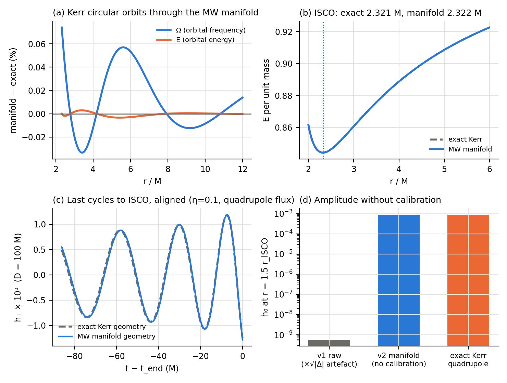

# Kerr spacetime v2 (Nov 2026): gravitational waves from the MW manifold, no amplitude calibration

v1 (January 2026, files one level up) needed a **10,804× auto-calibration** to get the gravitational-wave amplitude right.
v2 removes it. The waveform amplitude and phase now come straight from the geometry the MW manifold learned, with no tuning.



## Results (spin a = 0.9, all numbers from `results/gw_v2.json`)

| Quantity | Exact Kerr | MW manifold | Error |
|---|---|---|---|
| ISCO radius | 2.3209 M | 2.3224 M | 0.06% |
| Orbital frequency Ω(r), r_ISCO → 12 M | Bardeen–Press–Teukolsky | from metric at manifold reconstruction | max 0.074%, median 0.012% |
| Orbital energy E(r), r_ISCO → 12 M | BPT | same | max 0.0034% |
| GW amplitude h₀ at r = 1.5 r_ISCO (D = 100 M, μ = 0.1) | 8.864×10⁻⁴ | 8.858×10⁻⁴ | ratio 0.9993, **calibration factor 1.0** |
| Inspiral match, quadrupole flux, 12 M → ISCO, η = 0.1 (47.5 GW cycles) | — | — | **0.99972** |
| Inspiral match, quadrupole flux, 12 M → ISCO, η = 0.01 (474.7 cycles) | — | — | **0.99980** (0.11 cycle dephasing) |
| Inspiral match, 2.5PN flux, 12 M → 6 M, η = 0.1 / 0.01 | — | — | **0.99986 / 0.99974** |

The match is the normalised overlap, maximised over time and phase shift, with a flat noise spectrum. It compares the
waveform built from the manifold's geometry against the waveform built from exact Kerr, using the same
inspiral model in both cases.

Held-out round-trip of the manifold over 20,000 unseen spacetime points: median |Δr| = 0.0034 M,
|Δθ| = 1.8×10⁻⁴ rad, |Δφ| = 2.7×10⁻⁴ rad.

## What was wrong in v1, and the fix

`kerr_v2_gw.py` reproduces the v1 pipeline and measures each problem directly:

| v1 problem | Measured | v2 fix |
|---|---|---|
| Training data were not geodesics: circles with random radial jitter and θ linear in time | — | Exact timelike geodesics from Hamilton's equations, RK4 in float64; constraint \|H + ½\| ≤ 1.4×10⁻⁷ (median 3×10⁻¹⁶) over 674,651 points |
| The v1 VAE did not encode the orbit it was asked about | on the r = 3.48 M orbit, reconstructed r spans 3.6–12.4 M (median error 7.7 M) | log-r features and a β-VAE weight; median error 0.0034 M |
| The physics prior was computed but never used: `g_true`, `g_recon` existed in the model but did not enter the likelihood | — | MW metric prior: the Kerr metric at the reconstructed point must match the metric at the data point (relative σ = 1%) |
| The amplitude was multiplied by √\|Van Vleck\| ≈ 6×10⁻⁷, then rescaled back to a PN target | removing the VAE factor leaves the v1 match **unchanged (0.98507)**, so the geometry was not driving the waveform | No such factor. Ω(r) and E(r) are derived from the metric at the manifold reconstruction (autograd through encoder and decoder), then the standard quadrupole amplitude 4μr²Ω²/D. The calibration factor is 1.0 |

## Method

1. **Data** (`kerr_v2_data_train.py`). 3,000 timelike geodesics around a = 0.9 Kerr: inclined, eccentric and some plunging, r ∈ [1.65, 40] M.
2. **MW manifold** (same file). A Pyro VAE with an 8-D latent space on (r, θ, cos φ, sin φ), with three priors:
   - a Gaussian likelihood;
   - an N(0, I) latent prior at β = 10⁻³;
   - the MW physics prior on the metric.

   Training ran 80,000 steps on CPU (about 62 minutes).
3. **Geometry through the manifold** (`kerr_v2_gw.py`). For each r, the point is sent through the manifold (x̂ = decode(encode(x))) and the Kerr metric is evaluated at x̂. Its r-derivatives are taken by autograd through the network. The circular-orbit condition ∂ᵣg_tt + 2Ω∂ᵣg_tφ + Ω²∂ᵣg_φφ = 0 then gives Ω and E. The same code applied to the exact metric reproduces BPT to machine precision.
4. **Waveforms.** An adiabatic circular inspiral: dE/dt = −F with F = (32/5)η²v¹⁰f(v) and h = 4ηv²/D·e^(−2iΦ).

## Limits (stated plainly)

- **The inspiral model is basic.** It is the adiabatic quadrupole, or 2.5PN test-mass flux, model of a point mass on circular equatorial orbits. It is **not** a numerical-relativity or EOB waveform. The test isolates one question: does the manifold's geometry give the same waveform as exact Kerr geometry under the same waveform model? It does, to 0.9997–0.9999.
- **The 2.5PN arm stops at 6 M.** For a = 0.9, the test-mass 2.5PN flux factor f(v) reaches zero at r ≈ 4 M and is negative inside that radius, so that series cannot be used there. Only the quadrupole arm runs to the ISCO.
- **One spin, one mass ratio per run.** The manifold is trained at a = 0.9; it does not take spin as an input.
- **Not yet done:** SXS/NR comparison, an LIGO noise curve instead of flat noise, eccentric and inclined waveforms (the data already contain such orbits), and a spin-conditioned manifold.

## Run

```bash
python3 kerr_v2_data_train.py --steps 80000   # ~1 h CPU; writes data/, model/, results/train_*
python3 kerr_v2_gw.py                         # ~2 min; writes results/gw_v2.json, results/fig_kerr_v2.png
```
`kerr_v2_common.py` holds the exact Kerr formulas and the model class. The v1 diagnosis step needs `../kerr_vae.pth`
and `../gravitational_wave_inference_STABLE_9.py`.
