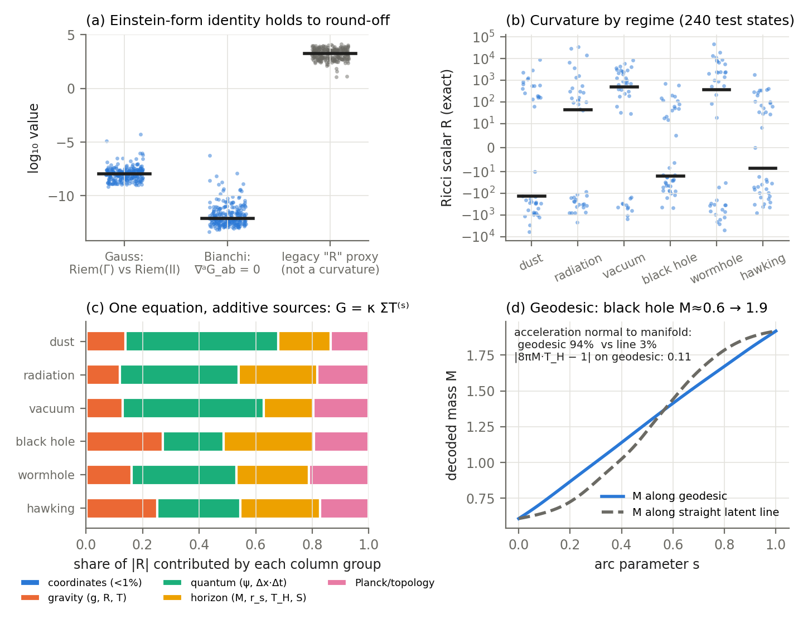

# EXPLORATORY_PHYSICS: from manifold to field equations (the reverse process)

> **Disclaimer.** We are **not** claiming to solve physics, quantum gravity or any open problem. This folder shows how the M-W manifold we learned translates into PDEs: the differential equations that manifold satisfies, written in the exact shape of Einstein's field equations. It is a demonstration that the method works, not a claim about nature.

**The three v2 PDFs:** [MW_Field_Equations_v2.pdf](papers/MW_Field_Equations_v2.pdf) · [mw_quantum_gravity_v2.pdf](papers/mw_quantum_gravity_v2.pdf) · [MW_Theory_Quantum_Mechanics_As_Geometry_v2.pdf](papers/MW_Theory_Quantum_Mechanics_As_Geometry_v2.pdf). Each has a section on falsifiable predictions.

## The idea: invert the process

**The standard way:** write the PDEs first (pen and paper), then build numerical solvers, meshes and discretisations to approximate them. A new theory can take years to reach a testable form.

**The M-W way:** supply the theories' constraints as Bayesian priors, let Pyro/PyTorch learn the joint **manifold**, and test the new idea *on the manifold*. Then convert the manifold into PDEs and papers. The manifold is where the theory is tested; the equations come last.

This is **computational constructivism applied to quantum gravity**: build the object first, then read off its laws. For a new idea such as this QG construction, it takes **a couple of weeks** from concept to tested object to Einstein-form equations, against **years** for the old route. People cannot construct a manifold of more than 4–5 dimensions by hand. Pyro builds a **20-dimensional** one (18 dimensions active) on a laptop, as shown here.

### Think manifold, not PDE

A PDE solver also uses geometry, but only cell by cell: it evaluates local tangents (derivatives) in each cell, and the solver stitches the cells into a mesh. The learned manifold *is* the global object: a smooth chart with exact derivatives at every point, which works as a mesh of arbitrary resolution with no meshing step. For the next generation of science, the tool is the ubiquitous Pyro + PyTorch laptop, and the habit is **manifold-level thinking** instead of pen-and-paper PDE thinking.

---

## What was done

1. **Validated the three March/January theory PDFs and the four `ARCHIVES/OLD_THEORY_ATTEMPT/` scripts (formerly `THEORY/`)** by re-running the scripts, unchanged, on the Nov-2026 v5 manifold (`legacy_rerun/`).
2. **Rebuilt the extraction exactly** (`code/`): the metric, connection, second fundamental form, Riemann and Ricci tensors and the Einstein tensor of the trained manifold, with exact derivatives, at 240 unseen test states for each model.
3. **Wrote new versions of the three PDFs** (`papers/`), with every number generated from the runs.

## Results (checkpoint `A_full_prior`, 240 unseen test states)

| What | Result |
|---|---|
| **Field equation of Einstein's form** | `G_ab = R_ab − ½ g_ab R = κ T^MW_ab`, with `T^MW` built from the manifold's extrinsic curvature |
| Two independent routes to the Riemann tensor agree | median **1.2×10⁻⁸** |
| Conservation `∇ᵃT^MW_ab = 0` (contracted Bianchi) | median **7.6×10⁻¹³** |
| Gravity and quantum sources add in one equation | `G = κ(T^grav + T^quant + T^hor + T^coord + T^Planck)`, exact to **10⁻¹⁵** |
| Every regime is curved by GR and QM content together | e.g. black hole: gravity 27%, quantum 21%, horizon 32% of \|R\| |
| Geodesic between a black hole of M≈0.6 and one of M≈1.9 | a continuous family of black holes with uniformly increasing mass; 94% of its acceleration is normal to the manifold (straight line: 3%) |
| Quantum phase connection `A = Im(ψ*dψ)/|ψ|²` | pure gauge (`F = 0` to 10⁻¹⁶): the ħA term adds only an endpoint phase |



Full numbers for both models (with and without M-W priors) are in [`results/exact_geometry.json`](results/exact_geometry.json) and [`results/exact_geometry_log.txt`](results/exact_geometry_log.txt).

## Falsifiable predictions

The framework makes a prediction that standard quantum mechanics does not (from `ARCHIVES/PDF_PAPERS_THEORY/Appendix_A_Falsifiable_Predictions.pdf`). Standard QM has ΔxΔp ≥ ħ/2 and ΔEΔt ≥ ħ/2, but **no lower bound on joint position–time localisation**. M-W predicts

**Δx · Δt ≥ ℓ_P² (1 + β R ℓ_P²)**,  with ℓ_P the Planck length and β an order-unity geometric coupling.

It is falsifiable at three independent levels, and **failure at any one falsifies it**:

1. **Existence:** is there any lower bound on Δx·Δt? Standard QM predicts none.
2. **Scale:** if a bound exists, is it set by the Planck area ℓ_P²?
3. **Geometry:** does the bound grow with curvature as 1 + βRℓ_P²?

The defining signature, playing the role Mercury's perihelion played for GR, would be a fundamental lower bound on joint spatial–temporal localisation that depends measurably on spacetime curvature. Candidate tests: ultra-cold atoms or trapped ions plus precision clocks, compared across gravitational environments. Further channels: corrections to the Hawking temperature, logarithmic corrections to black-hole entropy, and curvature-dependent primordial fluctuations.

**What the manifold can and cannot say** ([`results/uncertainty_check.json`](results/uncertainty_check.json)):
- The decoded bound Δx·Δt ≥ ℓ_P² holds on **239 of 240** test states (no-prior model: 240/240). This is a consistency check, not a test: the bound is built into the training data and into prior C3.
- With the **exact** Ricci scalar, β_eff ≈ 0 on the manifold (interquartile range −0.001 to 0.001; correlation with R −0.03). It must be, because the synthetic data have no curvature dependence. The earlier **β ≈ 3.24 is withdrawn.** It came from the v1 curvature proxy (not a curvature), and `virtual_test_script.py` kept only β values between 0.01 and 100. β remains a prediction for experiment. To test level 3 on a manifold, generate data with a curvature-dependent bound and recover β blind.

**Falsification tests already run on the manifold (each could have failed):**
- **Shuffle control:** same values, broken joint rows. Einstein residual 1.3% → 59.6%, Hawking R² 0.83 → 0.19. The relations live in the joint, not the columns.
- **Prior ablation:** Hawking R² 0.83 with M-W priors vs 0.42 without.
- **Extraction check:** Gauss (1.2×10⁻⁸) and Bianchi (7.6×10⁻¹³) identities hold with exact geometry. Both fail for the v1 extraction, whose Ricci trace is identically 0.

**ν > 1 test (run 2026-11-19, criteria pre-registered in [`results/nu_test_PREREGISTRATION.md`](results/nu_test_PREREGISTRATION.md) before training).**
The March 2026 prediction was that replacing the Student-t(ν = 0.8) prior with ν > 1 keeps GR but destroys the Planck/topology structure. On v5 we retrained with identical data, ν ∈ {0.8, 1.5, 3.0} × 2 seeds ([`results/nu_test.json`](results/nu_test.json), [`results/nu_test_verdict.json`](results/nu_test_verdict.json)):

| run | Einstein | Hawking R² | P1 flag acc | P2 flag MAE | P3 wormhole recall |
|---|---|---|---|---|---|
| ν = 0.8 (seeds 0, 1) | 1.30%, 1.22% | 0.83, 0.67 | 0.9989, 0.9989 | 0.0107, 0.0103 | 0.985, 0.985 |
| ν = 1.5 | 1.18%, 1.07% | 0.67, 0.60 | 0.9990, 0.9990 | 0.0107, 0.0103 | 0.983, 0.976 |
| ν = 3.0 | 0.89%, 1.28% | 0.52, 0.57 | 0.9990, 0.9990 | 0.0102, 0.0109 | 0.983, 0.979 |

- **GR preserved:** yes.
- **Planck structure degraded:** no. Only wormhole recall falls below the ν = 0.8 band, and the rule needs two of three measures.
- **Verdict under the pre-registered rule: the "destroys Planck structure" prediction is falsified on this toy setup.**
- **The March claim of a "0% Einstein residual" for ν > 1 is not reproduced.** ν > 1 gives 0.9–1.3%.

**What this does and does not say about ν = 0.8.** The test does not show that ν = 0.8 is worse. Every ν performs comparably on the Planck measures, so this synthetic data set does not separate the values. ν = 0.8 remains the modelling choice it was stated to be. One observation outside the pre-registered rule, so a hint only: the Hawking fit is weaker for ν > 1. Both ν = 3.0 seeds (R² 0.52, 0.57) fall below the ν = 0.8 band (0.67–0.83), and ν = 1.5 sits at its lower edge.

## Validation of the earlier PDFs and scripts

| Item | Finding | In v2 |
|---|---|---|
| `qg_extract_fast.py`: metric `g = JᵀJ` | **Correct.** This is the pullback metric. | kept, now with exact 2nd derivatives |
| `qg_extract_fast.py`: "Ricci scalar" | Not a curvature: it is `½(log det g + tr g⁻¹ − n)`, dominated by `1/λ_min` from unused latent axes. This produced v1's **R = 2.88×10⁷**. On v5 it gives 1.7×10³, while the exact \|R\| median is 307. | replaced by exact R |
| `qg_extract_pdes_fast.py`: Christoffel symbols | Built from differences between consecutive **random** samples, which are not neighbouring points. | replaced by exact Γ |
| `qg_extract_pdes_fast.py`: Ricci tensor | The kept terms are antisymmetric in (i,j), so `R = gⁱʲR_ij ≡ 0`. The rerun prints −1.3×10⁻¹³ against an input of 1.2×10⁷. | replaced; Ricci symmetric to 10⁻¹⁰ |
| v1 PDFs: "3.3% Einstein residual" | from the v4 pipeline with the column-index bug | 1.3% (v5) |
| v1 field equations for `A_i`, `F_ij`, Euler characteristic, unified `R_IJ` | not extracted from any manifold | `A` computed and found pure gauge; others not carried forward |
| Appendix A: β_eff ≈ 3.24 | computed with the proxy R and the condition number, keeping only β in [0.01, 100]; with exact R, β_eff ≈ 0 (the data have no R dependence) | withdrawn; β stays an experimental prediction |
| `mw_quantum_gravity.pdf` "five emergent properties" | only results 1–3 survive the corrected code and controls | kept 1–3, added the field equations |

`analyze_manifold.py` and `plot_manifold.py` only summarise and plot the `.npz` file, so they inherit the proxy "R". The outputs of all four scripts on v5 are in `legacy_rerun/`.

## New versions of the three PDFs

| v1 (in `ARCHIVES/OLD_THEORY_ATTEMPT/`) | v2 (here) |
|---|---|
| `MW_Field_Equations.pdf` | [`papers/MW_Field_Equations_v2.pdf`](papers/MW_Field_Equations_v2.pdf): Einstein-form equations read off the manifold, all checks, corrections to v1 |
| `mw_quantum_gravity.pdf` | [`papers/mw_quantum_gravity_v2.pdf`](papers/mw_quantum_gravity_v2.pdf): Student-t(ν=0.8) prior paper with the v5 controlled results and the field equations |
| `MW_Theory_Quantum_Mechanics_As_Geometry.pdf` | [`papers/MW_Theory_Quantum_Mechanics_As_Geometry_v2.pdf`](papers/MW_Theory_Quantum_Mechanics_As_Geometry_v2.pdf): the equivalence principle evaluated on the manifold (one metric, additive sources, physical geodesics, pure-gauge phase) |

The v1 files in [`OLD_THEORY_ATTEMPT/`](../../ARCHIVES/OLD_THEORY_ATTEMPT/) are left unchanged.

## How the geometry is computed

The decoder `f: U ⊂ ℝ¹⁸ → ℝ³⁰` (active latent axes → standardised data columns) is an immersion.

- `code/mw_taylor.py` propagates `f`, `∂f` and `∂²f` analytically through each layer (Linear, LayerNorm, tanh). It is exact and agrees with reverse-mode autodiff to 10⁻¹⁵. Nested forward-mode autodiff through LayerNorm gave a **wrong Hessian** in torch 2.13; a finite-difference check caught it.
- `g = ⟨∂f,∂f⟩`, `Γ = g⁻¹⟨∂f,∂²f⟩`, `II = P⊥∂²f`. Riemann comes from Gauss (`II·II`) and, independently, from `∂Γ + ΓΓ`, with `∂Γ` from 4th-order central differences of the exact Γ.
- Geodesic: discrete path-energy minimisation (Adam, then L-BFGS), checked by the normal-acceleration test `P∥ x'' = 0`.

## Reproduce (laptop CPU, about 15 minutes)

```bash
cd Nov-2026_tests/EXPLORATORY_PHYSICS/code
python3 mw_exact_geometry.py      # -> ../results/exact_geometry.json, _log.txt, _points.npz, geodesic_path_*.npz
python3 mw_berry_check.py         # -> ../results/berry_check.json
python3 mw_uncertainty_check.py   # -> ../results/uncertainty_check.json (Δx·Δt bound, β_eff)
python3 mw_exact_figures.py       # -> ../results/fig_exploratory.png, ../papers/fig_exploratory.pdf
python3 mw_paper_numbers.py       # -> ../papers/numbers.tex
cd ../papers && for f in *.tex; do pdflatex "$f"; done
../legacy_rerun/run_legacy.sh     # optional: the unchanged OLD_THEORY_ATTEMPT scripts on the v5 manifold
```

Inputs are the Nov-2026 checkpoints in `../results/checkpoints/`. Needs torch, pyro-ppl, numpy and matplotlib.

## Scope, again

The Einstein-form equation is an identity of any smooth immersed manifold. What the trained M-W manifold supplies is *which* manifold: its metric, curvature and source composition come from GR+QM data and the M-W priors. Latent coordinates are not spacetime coordinates, the ambient metric is the Euclidean metric of standardised data, and the data are synthetic. The claim is that **a learned manifold converts mechanically into field equations of Einstein's shape, with every term computed and checked.** It is not a claim that these are the equations of nature.

*Code implementation was assisted by AI coding tools; modelling choices and claims are the authors'.*
