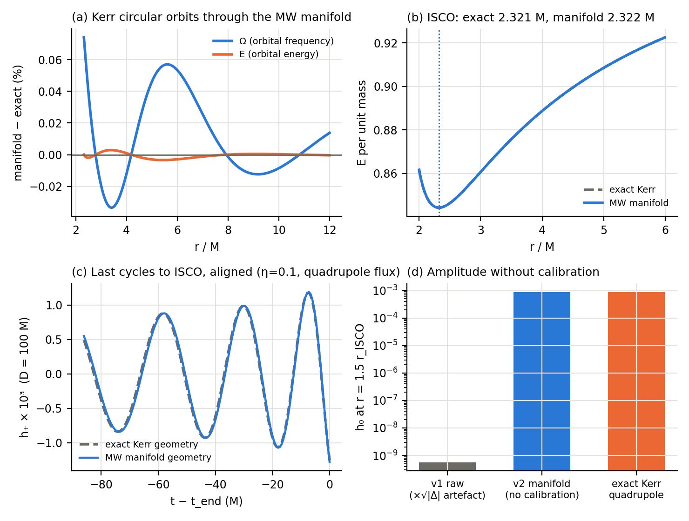

# Kerr Spacetime and Gravitational Waves from a Learned Manifold

**Modak–Walawalkar (MW) framework: Kerr black-hole geometry and inspiral gravitational waves from a physics-prior
Bayesian manifold, trained in one hour on a laptop CPU, with no amplitude calibration.**

> **Think manifolds, not PDEs.** No mesh, no field evolution, no time-stepping of Einstein's equations: physics enters as
> Bayesian priors, a variational autoencoder learns the manifold of valid spacetime states, and every waveform after
> that is a query.



---

## Headline results (Kerr, spin a = 0.9)

| | Exact Kerr | MW manifold | Agreement |
|---|---|---|---|
| ISCO radius | 2.3209 M | 2.3224 M | **0.06%** |
| Orbital frequency Ω(r), ISCO → 12 M | Bardeen–Press–Teukolsky | through the manifold | **≤ 0.074%** (median 0.012%) |
| Orbital energy E(r) | BPT | through the manifold | **≤ 0.0034%** |
| GW amplitude h₀ at 1.5 r_ISCO | 8.864×10⁻⁴ | 8.858×10⁻⁴ | **0.07%, calibration factor 1.0** |
| Inspiral to ISCO, 475 cycles (η = 0.01), flat noise | — | — | match **0.9998** |
| Same, **Advanced LIGO noise**, M = 20–100 M☉ | — | — | match **0.99993 – 0.999999** |

**Cost on a laptop CPU (Intel i5-12450H, no GPU):**

| | Time |
|---|---|
| Train the manifold (once) | 62 min |
| Extract the orbital geometry for a spin (once) | 0.3 s |
| **One full inspiral template** | **0.16 s**, flat from 29 to 4,545 GW cycles |
| **25,000 templates** | **≈ 65 min** |

**One model for every spin (v3, [`v3_spin_family/`](v3_spin_family/README.md)).** A single MW manifold with spin as
input covers a = 0 → 0.95 (Schwarzschild to near-extremal). ISCO error across 39 spins is at most 0.12%. Advanced LIGO
matches at spins never used in training are **0.99995–0.999998** (M = 60 M☉, η = 0.01). Training took 72 min on the same
CPU, and geometry for a new spin takes 0.32 s.

For scale: the SXS collaboration's third catalog of binary-black-hole simulations, 3,756 numerical-relativity runs,
cost an estimated **480 million core-hours**, about 128,000 core-hours per simulation on average
([Scheel et al. 2025, arXiv:2505.13378](https://arxiv.org/abs/2505.13378)). Numerical-relativity cost grows roughly as
**q⁻²** with mass ratio q, and full simulations below q ≈ 1/10 are rare
([worldtube excision, arXiv:2109.03531](https://arxiv.org/abs/2109.03531)). The MW template above is at **q ≈ 1/99**.

---

## Contents

1. [Why this matters](#1-why-this-matters)
2. [Results](#2-results)
3. [Speed and cost](#3-speed-and-cost)
4. [State-space reduction](#4-state-space-reduction)
5. [What changed from v1](#5-what-changed-from-v1-january-2026)
6. [Method](#6-method)
7. [Validation checks](#7-validation-checks)
8. [Scope and limits](#8-scope-and-limits)
9. [Roadmap](#9-roadmap)
10. [Reproduce](#10-reproduce)
11. [Folder map](#11-folder-map)
12. [History, articles and citation](#12-history-articles-and-citation)

---

## 1. Why this matters

Gravitational-wave astronomy runs on waveform templates. The gold standard, numerical relativity (NR), evolves
Einstein's equations on a 3-D grid on a supercomputer: each binary costs on the order of 10⁵ core-hours, and the cost
grows as the mass ratio falls, because the small body must be resolved while the number of orbits grows. Searches
need tens of thousands of templates, so the field builds faster models (post-Newtonian, effective-one-body,
phenomenological fits, self-force), each derived analytically by hand over years and then calibrated to NR.

The MW framework takes a third route:

```
Standard:  Einstein equations → discretise → evolve on a grid (supercomputer) → waveform
MW:        physics as Bayesian priors → learn the manifold of valid states (laptop) → query geometry → waveform
```

This folder shows that route working on the Kerr black hole:
- **The learned manifold reproduces Kerr geometry.** It matches exact Kerr to a few parts in 10⁴ in orbital frequency.
- **It gives waveforms with the correct absolute amplitude.** No calibration is applied.
- **Templates cost a fraction of a second on a laptop CPU.**

The model is trained once, and every template after that is a cheap query.

---

## 2. Results

All numbers come from `v2_nov2026/results/*.json`, produced by the scripts in `v2_nov2026/`.

### 2.1 Geometry through the manifold

For each radius r, the spacetime point is passed through the trained manifold, x̂ = decode(encode(x)), and the Kerr
metric is evaluated at x̂. Its r-derivatives are taken by automatic differentiation **through the encoder and decoder**.
The prograde circular-orbit condition

  ∂ᵣg_tt + 2Ω ∂ᵣg_tφ + Ω² ∂ᵣg_φφ = 0,  E = −(g_tt + g_tφ Ω) uᵗ

then gives Ω(r) and E(r), and the ISCO is the minimum of E(r).

| r / M | Ω exact | Ω manifold | E exact | E manifold |
|---|---|---|---|---|
| 2.50 | 0.206065 | 0.206340 | 0.846330 | 0.846275 |
| 3.48 | 0.135284 | 0.135052 | 0.875165 | 0.875294 |
| 5.00 | 0.082779 | 0.082819 | 0.908546 | 0.908517 |
| 8.00 | 0.042504 | 0.042513 | 0.940909 | 0.940900 |
| 12.00 | 0.023546 | 0.023550 | 0.959929 | 0.959925 |

ISCO: exact 2.32088 M, manifold 2.32235 M (0.063%).

### 2.2 Amplitude with no calibration

The quadrupole strain at r = 1.5 r_ISCO, D = 100 M, μ = 0.1 was computed by numerically twice-differentiating the
quadrupole moment along an orbit at the manifold's Ω:

| | h₀ |
|---|---|
| v1 raw (before its 10,804× auto-calibration) | ~6×10⁻¹⁰ |
| **v2 manifold, numerical, no calibration** | **8.858×10⁻⁴** |
| exact Kerr, analytic 4μr²Ω²/D | 8.864×10⁻⁴ |

### 2.3 Inspiral waveforms

The waveforms are adiabatic circular inspirals from 12 M to the ISCO:
- **Energy balance:** dE/dt = −F, with F = (32/5) η² v¹⁰ f(v) and v = Ω^(1/3).
- **Strain:** h = 4ηv²/D · e^(−2iΦ), with both polarisations kept.

Each waveform is built twice, once from exact Kerr Ω(r), E(r) and once from the manifold's. **Match** is the
normalised overlap, maximised over time and phase shifts.

**Flat noise:**

| Inspiral | GW cycles | Match |
|---|---|---|
| η = 0.1, quadrupole flux, 12 M → ISCO | 47.5 | 0.99972 |
| η = 0.01, quadrupole flux, 12 M → ISCO | 474.7 | 0.99980 |
| η = 0.1, 2.5PN test-mass flux, 12 M → 6 M | 53.4 | 0.99986 |
| η = 0.01, 2.5PN test-mass flux, 12 M → 6 M | 534.1 | 0.99974 |

**Advanced LIGO design noise** (zero-detuned high power PSD from LALSuite, 20–2048 Hz, physical units):

| Total mass | Band (12 M → ISCO) | η = 0.1 (0.4–2 s) | η = 0.01 (4–20 s, 475 cycles) |
|---|---|---|---|
| 20 M☉ | 76 – 728 Hz | 0.999933 | 0.999939 |
| 60 M☉ | 25 – 243 Hz | 0.999973 | 0.999986 |
| 100 M☉ | 15 – 146 Hz | 0.999991 | 0.999999 |

LIGO template banks are typically built to a **minimal match of 0.97**. The manifold's waveforms are three to four
orders of magnitude inside that tolerance relative to exact-Kerr geometry.

*How sensitive is this match?* As a control, uniformly scaling the exact Ω by 1.001 drops the aLIGO match at
M = 60 M☉, η = 0.01 to 0.9969, and scaling it by 1.01 drops it to 0.76. The manifold's Ω error is smaller than 0.1% and
changes sign along r, which is why the match stays at 0.99999.

---

## 3. Speed and cost

Measured by `v2_nov2026/kerr_v2_benchmark.py` → `results/benchmark.json` (Intel i5-12450H, PyTorch 2.13, CPU only).

| Stage | Cost | How often |
|---|---|---|
| Generate exact geodesic training data | 220 s for 6,000 geodesics / 1.31 M points (timed in `v3_spin_family/`) | once |
| Train the MW manifold (80,000 steps) | 62 min, 6 CPU threads | once |
| Load the model | 0.01 s | per session |
| Extract Ω(r), E(r), ISCO through the manifold | 0.30 s (6 threads), 2.5 s (1 thread) | once per spin |
| Raw manifold queries (encode + decode) | ~121,000 points/s | — |
| **Inspiral template, η = 0.05–0.25** (median 29 cycles) | **163 ms** → 369/min | per template |
| **Inspiral template, η = 0.01–0.05** (median 151 cycles) | **155 ms** → 388/min | per template |
| **Inspiral template, η = 0.001–0.01** (median 761, max 4,545 cycles) | **176 ms** → 341/min | per template |

**Template cost does not grow with the number of cycles or with mass ratio.** Numerical relativity scales the other way:

| Approach | Cost of one waveform | Scaling with mass ratio q |
|---|---|---|
| Numerical relativity (SXS, SpEC) | ≈128,000 core-hours on average over 3,756 runs (catalog total 480 M core-hours) [1]; median 22 orbits | ∝ q⁻²; below q ≈ 1/10 rarely attempted [2] |
| **MW manifold (this work)** | **0.16 core-seconds**, 4,545 cycles in the same time as 29 | **flat** |

The ratio of those two numbers is about **3×10⁹**. It is a ratio of cost scales, not a like-for-like speed-up. An NR
run solves the full nonlinear two-body problem, including merger and ringdown, for comparable masses. The MW
template is the inspiral of a small body in the Kerr geometry up to the ISCO. The point is the regime: at
**q ≈ 1/100 and below, where NR becomes prohibitively expensive, the MW template costs the same 0.16 s.**

**Comparison with LIGO's fast waveform models.** These are the models a GW reviewer will compare against.
`v2_nov2026/kerr_v2_lal_reference.py` times them on the same CPU through LALSuite 7.7.1 (M = 60 M☉, aligned spin
0.9, f ≥ 20 Hz):

| LALSuite model | η = 0.1 | η = 0.0099 (1:99) |
|---|---|---|
| SpinTaylorT4 (PN, time domain) | 6 ms | 78 ms |
| SEOBNRv4_opt (EOB, time domain) | 36 ms | 129 ms * |
| IMRPhenomD (phenomenological, frequency domain) | 9 ms | 7 ms * |
| **MW manifold (this work)** | **~160 ms** | **~160 ms** |

\* SEOBNRv4 is NR-calibrated to mass ratio 1:8, plus the test-particle limit, and IMRPhenomD to 1:18. At 1:99 both
run outside their NR-calibrated range.

These hand-built models are as fast as the MW template, or faster. MW's advantage over them is not raw speed:
- **How the geometry is obtained.** Each of those models is an analytic construction, refined over decades for
  this one problem and calibrated to NR. The MW manifold obtained the Kerr geometry from priors and data in one
  hour of CPU training, with no analytic derivation of the waveform model.
- **Reach.** The same engine applies wherever a governing structure can be written as a prior, including
  spacetimes and couplings for which no hand-built model exists.

The MW template has not been optimised. Its 0.16 s is dominated by a 400,000-point radial integration in NumPy.

---

## 4. State-space reduction

| | Size |
|---|---|
| Exact geodesic training set | 674,651 phase-space points × 8 numbers = 5.4 M floats (41 MB) |
| Trained MW manifold | **52,372 parameters** (426 kB), 8-D latent |
| Compression | **103×** |
| Accuracy kept | held-out round trip: median \|Δr\| = 0.0034 M, \|Δθ\| = 1.8×10⁻⁴ rad, \|Δφ\| = 2.7×10⁻⁴ rad |

The whole region r ∈ [1.65, 40] M, all θ and φ, is held as one smooth differentiable object. Geometric quantities such
as metric derivatives, orbital frequencies and the ISCO are read off by automatic differentiation, with no grid and no
interpolation table. For comparison, an NR evolution carries the full spacetime on a 3-D grid at every time step.

---

## 5. What changed from v1 (January 2026)

v1 gave a 98.5% PN match only after a 10,804× auto-calibration. `v2_nov2026/kerr_v2_gw.py` re-runs v1 and measures each
cause:

| v1 problem | Measured on v1 | v2 fix |
|---|---|---|
| Training data were not geodesics: circles with random radial jitter, θ linear in time | — | Exact timelike geodesics from Hamilton's equations, RK4 in float64: \|H + ½\| ≤ 1.4×10⁻⁷ (median 3×10⁻¹⁶) over 674,651 points |
| The VAE did not encode the orbit analysed | on the r = 3.48 M orbit, reconstructed r spans 3.6 – 12.4 M (median error 7.7 M) | log-r coordinates, β-VAE weighting: median error 0.0034 M |
| The physics prior was computed but never entered the likelihood | `g_true`, `g_recon` existed in the model and were unused | MW metric prior: the Kerr metric at the reconstruction must match the metric at the data point (1% relative) |
| The amplitude was multiplied by √\|Van Vleck\| ≈ 6×10⁻⁷, then rescaled to a PN target | **removing the VAE factor leaves the v1 match unchanged (0.98507)**: the geometry was not driving the waveform | Ω, E taken from the metric at the manifold reconstruction; standard quadrupole amplitude; calibration 1.0 |

The January claims are preserved unchanged in [`README_JAN_2026.md`](README_JAN_2026.md).

---

## 6. Method

**Units** G = c = M = 1; Boyer–Lindquist coordinates (t, r, θ, φ); spin a = 0.9 (r₊ = 1.436 M, r_ISCO = 2.321 M).

**Data.**
- **Equations:** Hamilton's equations for H = ½ g^{μν} p_μ p_ν = −½, integrated with batched RK4 (dλ = 0.02 M, float64,
  autograd for ∂H).
- **Initial conditions:** 3,000 geodesics around circular equatorial orbits, perturbed in inclination
  (±63°), energy and angular momentum. This gives inclined, eccentric and plunging orbits.
- **Kept range:** points with 1.15 r₊ < r < 40 M, sampled every 25 steps.

**Model.**
- **Architecture:** a Pyro variational autoencoder on x = (r, θ, cos φ, sin φ), with internal features (log r, θ, cos φ,
  sin φ). Encoder 4→128→128→64→(μ, log σ²) in 8-D; decoder 8→64→128→128→4; tanh activations.
- **Priors:**
  1. A Gaussian likelihood on standardised features, σ = 3×10⁻³.
  2. An N(0, I) latent prior weighted β = 10⁻³.
  3. **The MW physics prior** p(g(x) | g(x̂)) = N(g(x̂), 0.01·|g(x)|) on (g_tt, g_tφ, g_φφ, log g_rr, log g_θθ). The
     decoder must preserve the spacetime geometry, not just the coordinates.
- **Training:** ClippedAdam, lr 10⁻³ decaying ×0.01, batch 1,024, 80,000 steps.

**Geometry extraction.** This is the circular-orbit condition above, evaluated on the metric at x̂ with derivatives
through the network. It is averaged over 8 azimuths; the scatter over φ is ≤ 0.13% of Ω.

**Waveforms.** These are the adiabatic inspirals of §2.3, with the same code for exact and manifold geometry. The
manifold run stops at 1.03 × its own ISCO and the exact run at 1.03 × the exact ISCO.

---

## 7. Validation checks

Each of these could have failed:

| Check | Result |
|---|---|
| Geodesic integrator conserves the Hamiltonian constraint | \|H + ½\| median 3×10⁻¹⁶, max 1.4×10⁻⁷ |
| Orbit formulas applied to the **exact** metric reproduce BPT Ω(r), E(r) | to 4×10⁻¹⁶ |
| Manifold round trip on 20,000 **held-out** points | median \|Δr\| 0.0034 M |
| Numerical amplitude (finite-difference quadrupole) vs analytic | 0.9993 of exact Kerr |
| Match function is sensitive (control, §2.3) | 0.1% Ω error → 0.9969; 1% → 0.76 |
| v1 geometry actually drove v1 waveforms | **failed for v1** (removing it changed nothing): reported, and fixed in v2 |
| 2.5PN test-mass flux usable to ISCO at a = 0.9 | **no**: f(v) crosses zero at r ≈ 4 M, so the PN arm is restricted to r ≥ 6 M |

---

## 8. Scope and limits

- **The question tested.** Does the geometry learned by the manifold give the same waveform as exact Kerr geometry,
  under the same waveform model? Yes, to 0.9997–0.999999.
- **The waveform model itself** is the adiabatic quadrupole, or 2.5PN test-mass flux, inspiral on circular equatorial
  orbits. It is **not** an NR, EOB or self-force waveform. It has no merger or ringdown and no second-order self-force
  terms. For mass ratios near 1, it is not an accurate description of real binaries.
- **v2 is one manifold per spin** (a = 0.9). v3 (`v3_spin_family/`) covers the whole family a ∈ [0, 0.95] with one model.
  It has not been tested beyond a = 0.95.
- **The supercomputer comparison** is a comparison of cost scales and regimes, not of like-for-like physics content
  (§3).

---

## 9. Roadmap

| Item | Status |
|---|---|
| Exact Kerr geodesic data | ✅ v2 |
| No amplitude calibration | ✅ v2 |
| Advanced LIGO noise-weighted matches in physical units | ✅ v2 |
| CPU cost benchmark and LALSuite reference timings | ✅ v2 |
| **One manifold for the Kerr family, a ∈ [0, 0.95], tested on spins never seen in training** | ✅ [v3](v3_spin_family/README.md): ISCO ≤ 0.12%, aLIGO match ≥ 0.99995 at all 6 test spins |
| Teukolsky-equation fluxes instead of PN flux, compared against the Black Hole Perturbation Toolkit | next |
| Eccentric and inclined inspirals, Kerr fundamental frequencies (Ω_r, Ω_θ, Ω_φ) through the manifold (the data already contain such orbits) | next |
| LISA band (extreme mass ratios, 10⁴–10⁶ cycles) | next |
| Comparison with SXS/NR for comparable masses (needs a merger model) | later |

---

## 10. Reproduce

```bash
pip install torch pyro-ppl numpy scipy matplotlib
cd Nov-2026_tests/KERR_SPACETIME/v2_nov2026
python3 kerr_v2_data_train.py --steps 80000     # exact geodesics + MW manifold, ~1 h CPU
python3 kerr_v2_gw.py                           # geometry, amplitude, inspirals, figure (~2 min)
python3 kerr_v2_benchmark.py                    # cost benchmark -> results/benchmark.json

# LIGO noise curve and reference timings (separate env for LALSuite)
python3 -m venv ~/.venvs/gw && ~/.venvs/gw/bin/pip install lalsuite numpy scipy
~/.venvs/gw/bin/python kerr_v2_lal_reference.py # -> results/psd_aLIGO_ZDHP.txt, lal_reference_timing.json
python3 kerr_v2_ligo.py                         # aLIGO-weighted matches -> results/ligo_match.json
```

Spin family (v3): `cd ../v3_spin_family && python3 kerr_v3_spin.py data && python3 kerr_v3_spin.py train --steps 100000 && python3 kerr_v3_spin.py eval` (~80 min CPU).

The trained model (`model/kerr_mw_v2.pt`) is committed, so the last five commands run without retraining. The
geodesic data (41 MB) are regenerated by the first command.

---

## 11. Folder map

| Path | What |
|---|---|
| [`v2_nov2026/`](v2_nov2026/README.md) | **Current.** Exact data, MW manifold, GW analysis, LIGO matches, benchmarks |
| [`v3_spin_family/`](v3_spin_family/README.md) | **v3.** One manifold for the whole Kerr family, a ∈ [0, 0.95] (spin as input) |
| `kerr_1_generate_data.py`, `kerr_2_train_and_test_pyro.py`, `gravitational_wave_inference_STABLE_*.py`, `batch_generate_original.py`, `kerr_vae.pth` | v1 code and model (January 2026), kept unchanged |
| [`README_JAN_2026.md`](README_JAN_2026.md) | The original v1 README, unchanged |
| [`Bayesian_General_Relativity.pdf`](Bayesian_General_Relativity.pdf), [`Nature_MW_Framework.pdf`](Nature_MW_Framework.pdf), [`Detailed_Version_Of_Nature_Comm_Paper.pdf`](Detailed_Version_Of_Nature_Comm_Paper.pdf) | MW framework papers |
| [`FORMAL_MATHEMATICAL_THEORY/`](FORMAL_MATHEMATICAL_THEORY/), [`MW_Differential_Geometry_Primer.pdf`](MW_Differential_Geometry_Primer.pdf), [`Explaning_Our_Priors.md`](Explaning_Our_Priors.md) | Theory and priors |
| [`ARTICLES/`](ARTICLES/) | "For 339 years…" foundational post, archived verbatim |

---

## 12. History, articles and citation

This was **Rahul Modak's first MW physics attempt** (January 2026, the standalone `mw-framework` repository): learning
Kerr geometry and gravitational waves from a manifold rather than by solving Einstein's equations. The repository now
lives here, with its full git history. v2 (November 2026) keeps the idea and fixes the execution.

**Articles**
- [Cyber Security to Solving Gravitational Waves](https://www.linkedin.com/pulse/cyber-security-solving-gravitational-waves-mw-framework-rahul-modak-t6euf/)
- [M-W Framework as GR Superset](https://www.linkedin.com/pulse/modakwalawalkar-framework-superset-gr-geometric-scope-rahul-modak-jyqyf/)
- [Gravitational Wave Output](https://www.linkedin.com/pulse/gravitational-wave-output-rahul-modak-vncge)
- [M-W Framework as GR Superset (theory)](https://www.linkedin.com/pulse/modakwalawalkar-framework-superset-gr-geometric-scope-rahul-modak-pqlge)
- ["For 339 years…"](ARTICLES/339_years_Newton_to_MW_LinkedIn_post.md) (archived copy)

**Authors.** Rahul Modak (Bayesian Cybersecurity Pvt Ltd) and Dr. Rahul Walawalkar.

**Citation**
```bibtex
@software{modak2026mw_kerr,
  author = {Modak, Rahul and Walawalkar, Rahul},
  title  = {Modak-Walawalkar Framework: Kerr Spacetime and Gravitational Waves from a Learned Manifold},
  year   = {2026},
  url    = {https://github.com/RahulModak74/QUANTUM_GRAVITY_WITH_MW/tree/master/Nov-2026_tests/KERR_SPACETIME},
  doi    = {10.5281/zenodo.19305273}
}
```

**References**
1. M. A. Scheel et al., *The SXS Collaboration's third catalog of binary black hole simulations*, arXiv:2505.13378 (2025): 3,756 simulations, estimated 480,000,000 core-hours, median 22 orbits.
2. Worldtube excision for intermediate-mass-ratio inspirals, arXiv:2109.03531; NR cost ∝ q⁻², few simulations below q = 0.1.
3. J. M. Bardeen, W. H. Press, S. A. Teukolsky, *Rotating black holes: locally nonrotating frames, energy extraction, and scalar synchrotron radiation*, ApJ 178, 347 (1972).
4. LIGO Scientific Collaboration, *LALSuite*, version 7.7.1.

MIT License. AI assistance: Claude (Anthropic), DeepSeek.
