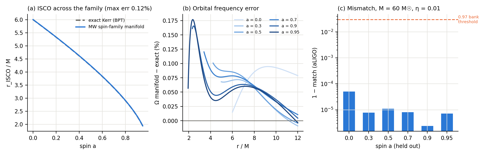

# Kerr v3: one MW manifold for the whole Kerr family (spin 0 → 0.95)

v2 learned the geometry of a single black hole (a = 0.9). v3 trains **one** conditional MW manifold whose decoder takes
the spin **a** as an input. It covers every spin from Schwarzschild (a = 0) to near-extremal (a = 0.95). The checks
below then pull the geometry and gravitational waves for any spin from that single model.



## Results

All numbers come from `results/spin_family.json`. "Exact" means Bardeen–Press–Teukolsky closed forms.

| Spin a | ISCO exact (M) | ISCO manifold (M) | ISCO error | Ω error, max (median) | E error, max | aLIGO match, M = 60 M☉, η = 0.01 | GW cycles |
|---|---|---|---|---|---|---|---|
| 0.00 | 6.0000 | 6.0006 | 0.010% | 0.095% (0.086%) | 0.0023% | **0.999949** | 245 |
| 0.30 | 4.9786 | 4.9809 | 0.047% | 0.072% (0.048%) | 0.0020% | **0.999992** | 313 |
| 0.50 | 4.2330 | 4.2360 | 0.071% | 0.101% (0.056%) | 0.0031% | **0.999989** | 362 |
| 0.70 | 3.3931 | 3.3962 | 0.089% | 0.120% (0.065%) | 0.0038% | **0.999992** | 415 |
| 0.90 | 2.3209 | 2.3240 | 0.135% | 0.166% (0.053%) | 0.011% | **0.999998** | 475 |
| 0.95 | 1.9372 | 1.9383 | 0.052% | 0.177% (0.049%) | 0.021% | **0.999993** | 492 |

- **ISCO scan, 39 spins from 0 to 0.95:** maximum error 0.12%, median 0.099%. This is panel (a). The exact and
  manifold curves lie on top of each other.
- **Worst aLIGO mismatch across the family: 5×10⁻⁵ (at a = 0).** That is about 600 times below the 0.03 mismatch
  (0.97 match) used as the template-bank standard.
- **Amplitude:** no calibration factor anywhere. The amplitude follows from Ω(r) through the manifold, as in v2.
- **How the evaluation spins relate to training.** Training spins are drawn continuously and uniformly from
  [0, 0.95], one per geodesic, 6,000 values in all. None of the evaluation spins is a training value, so every row is
  an interpolation within the trained range. a = 0 and a = 0.95 sit at its edges.

### Compared with v2 (one spin only)

| | v2 (a = 0.9 only) | v3 at a = 0.9 (whole family) |
|---|---|---|
| ISCO error | 0.06% | 0.14% |
| Ω max error | 0.074% | 0.17% |
| aLIGO match, M = 60, η = 0.01 | 0.999986 | 0.999998 |

The family model gives up a little pointwise accuracy relative to the single-spin specialist. Its waveform matches
are unchanged at the 10⁻⁵ level. One model replaces a separate model per spin.

## Cost (laptop CPU, i5-12450H, no GPU)

| Stage | Time |
|---|---|
| Exact geodesic data: 6,000 geodesics, 1.31 M phase-space points, \|H + ½\| ≤ 5.7×10⁻⁷ | **220 s** |
| Training, 100,000 steps, 6 threads | **71.5 min** (once, for every spin) |
| Extract Ω(r), E(r), ISCO for a new spin | **0.32 s** |
| One inspiral template | ~0.16 s (same integrator as v2) |

**State-space reduction:** 1.31 M points × 8 phase-space floats ≈ 10.5 M numbers are held by a 75,508-parameter
model. That is a **139× compression**, and it now spans a whole family of spacetimes rather than one.

## Method (differences from v2)

- **Data:** batched RK4 on Hamilton's equations, float64. Each geodesic gets its own spin a ~ U(0, 0.95). Starting
  radius r₀ ≥ 1.15 r_photon(a). Trajectories are cut at r > 1.15 r₊(a). Orbits are inclined (θ₀ = π/2 ± 1.1) and
  eccentric (L scaled by 0.75–1.05).
- **Model:** `KerrSpinVAE`. The encoder is 5 → 160 → 160 → 64 (input: log-r features plus spin) into an 8-D latent.
  The decoder is (8 + spin) → 64 → 160 → 160 → 4. Spin enters both networks, normalised to [−1, 1]. The decoded
  radius is floored at 1.05 r₊(a).
- **Priors:** the same MW metric prior as v2, applied with each point's own spin. The Kerr metric at the
  reconstruction must match the metric at the data point.
- **Geometry and waveforms:** the same as v2. The metric is evaluated at x̂ = decode(encode(x)), with ∂ᵣ taken by
  autograd. The circular-orbit condition gives Ω and E, and the ISCO is the minimum of E. The inspiral uses the
  quadrupole flux, and the aLIGO ZDHP noise-weighted match runs over 20–2048 Hz (from `../v2_nov2026/kerr_v2_ligo.py`).

## Scope

The scope is the same as v2. These are circular, equatorial, adiabatic inspirals under a PN-type flux, compared
against exact Kerr geometry under the same waveform model. They are not compared against numerical relativity. There
is no merger or ringdown.

## Reproduce

```bash
cd Nov-2026_tests/KERR_SPACETIME/v3_spin_family
python3 kerr_v3_spin.py data                   # ~4 min  -> data/kerr_family_v3.npz (93 MB, not committed)
python3 kerr_v3_spin.py train --steps 100000   # ~72 min -> model/kerr_mw_v3_spin.pt (committed)
python3 kerr_v3_spin.py eval                   # ~1 min  -> results/spin_family.json, fig_spin_family.png
```

`eval` uses the aLIGO noise curve in `../v2_nov2026/results/psd_aLIGO_ZDHP.txt`. Logs are in `results/*_log.txt`.
