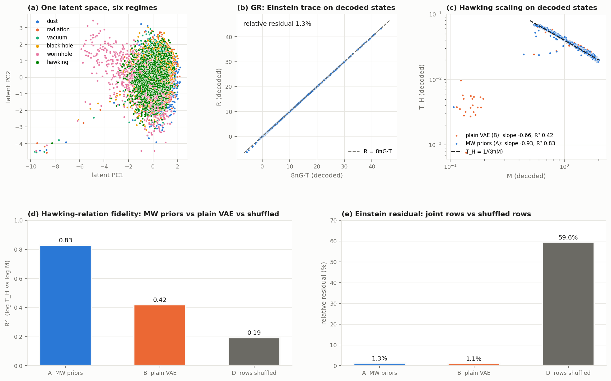

# Nov-2026 tests — one M-W manifold for GR + QM

Revision of the March 2026 quantum-gravity demonstration with improved code and controlled runs.
Paper: [`paper/mw_joint_manifold_gr_qm_nov2026.pdf`](paper/mw_joint_manifold_gr_qm_nov2026.pdf)

## Three results

| Result | Evidence (decoded test states) |
|---|---|
| **1. One VAE holds GR + QM jointly** | Einstein trace residual **1.3%**; Hawking T_H ∝ M^−0.93 (R² 0.83), from a single latent point |
| **2. M-W priors improve joint fidelity** | Hawking R² **0.83 with M-W priors vs 0.42** for the same VAE without them |
| **3. The manifold carries the joint, not the columns** | Shuffling columns within each regime (same values, broken rows): Einstein 1.3% → **59.6%**, Hawking R² → 0.19 |

## The reverse process: manifold → field equations

The usual route goes from PDEs to numerics. Here the manifold comes first: the theory is tested on it, and its PDEs are read off afterwards. [`EXPLORATORY_PHYSICS/`](EXPLORATORY_PHYSICS/) computes the exact geometry of this manifold and writes its field equation in Einstein's form, `G_ab = κ T^MW_ab`. Gravity and quantum sources add in one equation; Gauss holds to 10⁻⁸ and Bianchi to 10⁻¹². The folder also has v2 of the three theory PDFs. Disclaimer: this is not a claim to have solved physics.

## Kerr spacetime and gravitational waves

[`KERR_SPACETIME/`](KERR_SPACETIME/README.md) routes Kerr black-hole geometry through a learned MW manifold (Kerr metric supplied as the prior) and builds inspiral waveforms from it with no amplitude calibration. Matched against exact Kerr under Advanced LIGO noise, v2 reaches 0.99993–0.999999, and v3 uses one model for all spins a = 0 → 0.95.

## Structural position (paper, Table 1)

| Approach | Extra dim. | Discretise | AdS only | Single object |
|---|---|---|---|---|
| String theory | Yes | No | Partial | No |
| LQG | No | Yes | No | No |
| CDT | No | Yes | No | No |
| AdS/CFT | Yes | No | Yes | No |
| **M-W (this work)** | **No** | **No** | **No** | **Yes** |

The other approaches are full theories of quantum gravity. M-W is compared on structure: one learned manifold that holds GR and QM content together, so theories are combined by joint density estimation instead of by coupling their equations. **M-W removes the coupling step that PDE-based methods require.**



## What changed from the earlier (v4) code

- **Data** (`qg_toy_data_generator_v5.py`): every row is one draw from one joint distribution, so each physical parameter is sampled once and all columns are derived from it. v4 sampled the black-hole mass twice. Hawking rows now carry their hole's mass. The uncertainty column stores Δx·Δt.
- **Priors** (`qg_toy_vae_trainer_v5.py`): columns are read by name. In v4, indices 24–29 were off by one, so priors C3, C4 and C6 acted on the wrong columns.
- Architecture, ELBO and prior distributions are otherwise as in v4.

## Run it

```bash
cd code
python3 qg_v5_experiments.py        # all runs -> ../results/results.json, log.txt (~12 min/run on RTX 3050)
python3 qg_v5_figures.py            # trains/loads A and B, writes ../results/fig_v5.png and ../paper/fig_v5.pdf
cd ../paper && pdflatex mw_joint_manifold_gr_qm_nov2026.tex
```

Needs torch, pyro-ppl, numpy and matplotlib. `results.json` holds every measure the experiment script computes.
