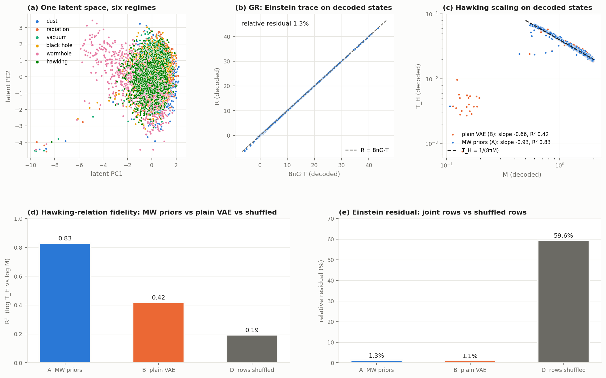
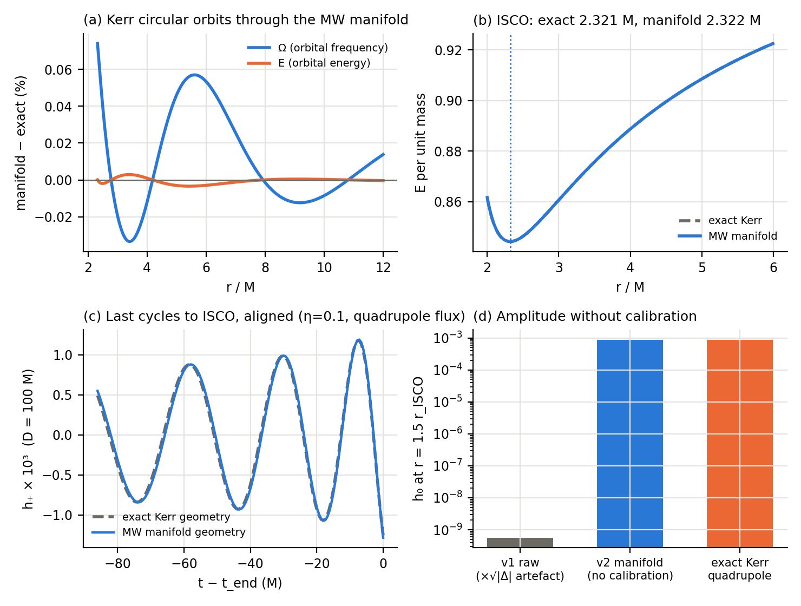

# QUANTUM_GRAVITY_WITH_MW

**One physics-prior Bayesian manifold that holds general relativity and quantum mechanics together**, built with the Modak–Walawalkar (MW) framework.

> **Think manifolds, not PDEs.**

---

## Start here: `Nov-2026_tests/` (current)

The current code, results and paper are in **[`Nov-2026_tests/`](Nov-2026_tests/)**.

- **Paper (v2, Nov 2026):** [`Nov-2026_tests/paper/mw_joint_manifold_gr_qm_nov2026.pdf`](Nov-2026_tests/paper/mw_joint_manifold_gr_qm_nov2026.pdf)
- **Code:** [`Nov-2026_tests/code/`](Nov-2026_tests/code/)
- **Results:** [`Nov-2026_tests/results/`](Nov-2026_tests/results/)

### Three results

| Result | Evidence (decoded test states) |
|---|---|
| **1. One VAE holds GR + QM jointly** | Einstein trace residual **1.3%**; Hawking T_H ∝ M^−0.93 (R² 0.83), from a single latent point |
| **2. MW priors improve joint fidelity** | Hawking R² **0.83 with MW priors vs 0.42** for the same VAE without them |
| **3. The manifold carries the joint, not the columns** | Shuffling columns within each regime (same values, broken rows): Einstein 1.3% → **59.6%**, Hawking R² → 0.19 |



### Structural position

| Approach | Extra dim. | Discretise | AdS only | Single object |
|---|---|---|---|---|
| String theory | Yes | No | Partial | No |
| LQG | No | Yes | No | No |
| CDT | No | Yes | No | No |
| AdS/CFT | Yes | No | Yes | No |
| **MW (this work)** | **No** | **No** | **No** | **Yes** |

The other approaches are full theories of quantum gravity. MW is compared on structure: one learned manifold that holds GR and QM content together. **MW removes the coupling step that PDE-based methods require**, so coupling theories becomes joint density estimation on one manifold.

### Think manifolds, not PDEs

Traditional coupled-PDE solvers compute trajectories on a discretized mesh by evaluating local tangent spaces (derivatives). This local approach requires mesh refinement, interface conditions, and time-stepping, which become intractable when the system spans more than 55 orders of magnitude.

The MW framework abandons solving. Instead, it uses the governing equations as Bayesian priors to carve out the valid region of a joint state space. A variational autoencoder then learns the density of this valid region: the solution manifold. The VAE does not march forward in time; it represents the space of valid states. **By replacing local tangent approximations with a global manifold representation, MW removes the structural need for meshes, stiffness handling, and scale-bridging time steps.**

*The present tests use Planck units over a moderate range; the cross-scale case is the setting this approach is designed for and the next demonstration (paper v2, Section 3).*

### The reverse process: manifold → field equations

The standard route goes from PDEs to numerics. MW also runs **in reverse**: the trained manifold is where the theory is tested, and only then is it converted to PDEs and papers. **[`Nov-2026_tests/EXPLORATORY_PHYSICS/`](Nov-2026_tests/EXPLORATORY_PHYSICS/)** reads the field equations off the trained 20-D manifold with exact derivatives and writes them in Einstein's form, `G_ab = κ T^MW_ab`. Gravity and quantum sources add in one equation, the Gauss identity holds to 10⁻⁸, and conservation `∇ᵃT_ab = 0` holds to 10⁻¹². The same folder validates the earlier theory scripts and has v2 of the three theory PDFs. The falsifiable prediction, a position–time bound Δx·Δt ≥ ℓ_P²(1 + βRℓ_P²) testable at three levels (existence, Planck scale, curvature dependence), is restated there together with what the manifold can and cannot test. The March 2026 prediction that a Student-t prior with ν > 1 would destroy the Planck/topology structure was tested under pre-registered criteria and **falsified on this toy setup**: all ν values perform comparably, and ν = 0.8 remains the modelling choice. *Disclaimer: this shows what the PDEs of our learned manifold would be. It is not a claim to have solved physics.*

### Kerr spacetime and gravitational waves: [`KERR_SPACETIME/`](KERR_SPACETIME/)

Rahul Modak's first MW physics attempt (January 2026, formerly the standalone `mw-framework` repo) routed Kerr black-hole geometry and gravitational waves through a learned manifold. It is now part of this repo. **v2 (Nov 2026)** retrains it on exact Kerr geodesics with the Kerr metric as an MW physics prior, computes orbital geometry through the manifold, and **removes the 10,804× amplitude calibration** v1 needed:

| Spin a = 0.9 | Exact Kerr | MW manifold |
|---|---|---|
| ISCO | 2.3209 M | 2.3224 M (0.06%) |
| Orbital frequency, ISCO → 12 M | BPT | max error 0.074% |
| GW amplitude at 1.5 r_ISCO | 8.864×10⁻⁴ | 8.858×10⁻⁴, **calibration factor 1.0** |
| Inspiral to ISCO, η = 0.01 (475 cycles) | — | match **0.9998** |
| Same, Advanced LIGO noise, M = 20–100 M☉ | — | match **0.99993–0.999999** |
| Training, laptop CPU | — | 62 min (one spin), 72 min (all spins) |

**v3** ([`KERR_SPACETIME/v3_spin_family/`](KERR_SPACETIME/v3_spin_family/README.md)) is one manifold for the whole Kerr family, spin a = 0 → 0.95. ISCO error is at most 0.12% over 39 spins. Advanced LIGO matches are 0.99995–0.999998 at six spins not used in training. It trains in 72 min on a laptop CPU.

This is a controlled validation. The analytic Kerr metric is supplied as the prior, and the test is whether geometry carried through the learned manifold stays accurate enough for gravitational-wave analysis. The waveforms come from the same adiabatic inspiral model on both sides, not from NR, and no speed advantage over LIGO's waveform models is claimed. The next step is inferring the metric from orbits alone. Details, limits and anticipated questions are in [`KERR_SPACETIME/README.md`](KERR_SPACETIME/README.md).



### Run it

```bash
pip install torch pyro-ppl numpy matplotlib
cd Nov-2026_tests/code
python3 qg_v5_experiments.py   # all runs -> ../results/results.json (~12 min per run on an RTX 3050)
python3 qg_v5_figures.py       # figure -> ../results/fig_v5.png and ../paper/fig_v5.pdf
```

Details are in [`Nov-2026_tests/README.md`](Nov-2026_tests/README.md).

---

## Repository map

| Path | What it is | Status |
|---|---|---|
| [`Nov-2026_tests/`](Nov-2026_tests/) | Improved code (v5), controlled runs, paper v2, LinkedIn post | **Current** |
| [`Nov-2026_tests/EXPLORATORY_PHYSICS/`](Nov-2026_tests/EXPLORATORY_PHYSICS/) | Reverse process: Einstein-form field equations read off the manifold; v2 of the three theory PDFs; validation of the `ARCHIVES/OLD_THEORY_ATTEMPT/` scripts; ν > 1 test | **Current** |
| [`KERR_SPACETIME/`](KERR_SPACETIME/) | Kerr black hole and gravitational waves from an MW manifold (formerly the `mw-framework` repo, Jan 2026); [`v2_nov2026/`](KERR_SPACETIME/v2_nov2026/README.md) removes the 10,804× amplitude calibration; [`v3_spin_family/`](KERR_SPACETIME/v3_spin_family/README.md) covers all spins with one model | **Current** (v2, v3) |
| `qg_toy_data_generator_v4.py`, `qg_toy_vae_trainer_v4.py` | March 2026 data generator and trainer behind the first paper | Archive |
| `qg_toy_data_generator.py`, `qg_toy_vae_trainer.py`, `qg_toy_visualizer.py` | Earlier versions and visualiser | Archive |
| `qg_manifold_visualization_clean.png` | March 2026 figure | Archive |
| `create_mercury_orbital_data.py` | Mercury orbital data generator | Archive |
| [`ARCHIVES/OLD_THEORY_ATTEMPT/`](ARCHIVES/OLD_THEORY_ATTEMPT/) | Formerly `THEORY/`. March 2026 paper (`mw_quantum_gravity.pdf`), manifold and PDE extraction tools, theory notes (v2 of the three PDFs and corrected extraction: `Nov-2026_tests/EXPLORATORY_PHYSICS/`) | Archive |
| [`ARCHIVES/PDF_PAPERS_THEORY/`](ARCHIVES/PDF_PAPERS_THEORY/) | MW theory documents: field equations, QM as geometry, formal theory, differential-geometry primer | Theory |
| `MW_Framework_Quantum_Vision.pdf` | MW framework vision document | Theory |
| `STATUS_OF_QR_GM_DATA.md` | March 2026 response to reviewer objections | Archive |
| `LINKEDIN_ARTICLE.md` | March 2026 article | Archive |
| [`README_MARCH_2026.md`](README_MARCH_2026.md) | Full previous README | Archive |

The archive files are kept unchanged for reference and reproducibility. Paper v2 in `Nov-2026_tests/` supersedes the March 2026 preprint (Zenodo [10.5281/zenodo.19304813](https://zenodo.org/records/19304813)).

### What improved in v5

- **Data:** every row is one draw from one joint distribution, so each physical parameter is sampled once and all columns are derived from it.
- **Priors:** columns are read by name, so each physics prior acts on the intended column.
- **Controls:** each run is compared against a plain VAE and a shuffled-rows control.

---

## Citation

```bibtex
@software{modak2026quantum_gravity_mw_v2,
  author = {Modak, Rahul and Walawalkar, Rahul},
  title  = {One Physics-Prior Bayesian Manifold Jointly Encodes General-Relativistic
            and Quantum Constraints: Controlled Tests of the Modak--Walawalkar Framework},
  year   = {2026},
  month  = {11},
  url    = {https://github.com/RahulModak74/QUANTUM_GRAVITY_WITH_MW/tree/master/Nov-2026_tests},
  note   = {Paper v2; supersedes doi:10.5281/zenodo.19304813}
}
```

## Contact

**Rahul Modak**: rahul.modak@bayesiananalytics.in
Bayesian Cybersecurity Pvt Ltd, Mumbai/Thane, India

**Dr. Rahul Walawalkar**
Carnegie Mellon University; NETRA, Pune; Caret Capital

[MW Framework](https://github.com/RahulModak74/mw-framework)

## License

MIT, open for academic research. Commercial licensing for battery analytics and RF cybersecurity is separate.

---

Built on [PyTorch](https://pytorch.org) and [Pyro](https://pyro.ai). Code implementation was assisted by AI coding tools (Claude, Qwen, DeepSeek); all modelling choices and claims are the authors'.

**Think manifolds, not PDEs.**
